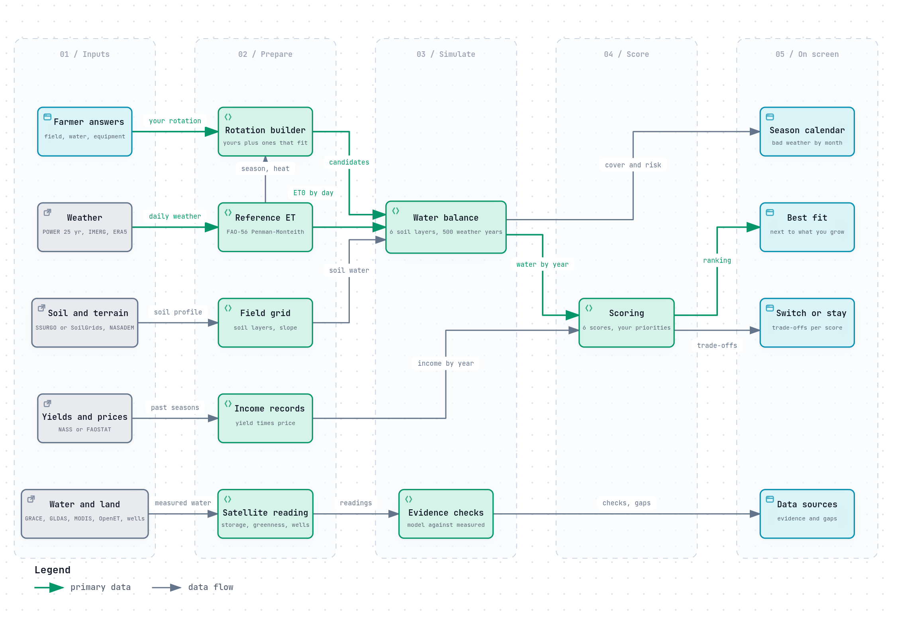

<p align="center">
  <picture>
    <source media="(prefers-color-scheme: dark)" srcset="frontend/public/brand/logo-mark-dark.svg">
    
  </picture>
</p>

<h1 align="center">Leyar Shift</h1>

<p align="center"><strong>NASA Space Apps Challenge 2026</strong></p>
<p align="center">Created by OptimusTechnica</p>

<p align="center">
  <a href="https://leyarshift.earth">Live site</a> ·
  <a href="https://leyarshift.earth/resources">Data sources</a>
</p>

---

**Leyar** comes from the Burmese word လယ်ယာ (le yar), meaning farmland: the paddy fields and upland farms that feed Myanmar. The **shift** is the change a farmer makes in what that land grows.

Leyar Shift helps a farmer choose their next crop rotation. Mark a field on a satellite map, say how it gets water, what equipment you have, what matters most to you and what you grow now. Leyar Shift tests that rotation against the others that suit the field and shows the best fit next to what you grow today: the water it needs, the income in your own currency, and how many days a year bad weather puts the crop at risk. Every number comes with a range and names its source.

## How it works

<p align="center">
  
</p>

The six scores are water needed, soil health, soil washing away, risk from bad weather, breaking pest cycles and income. When two rotations land about equally, Leyar Shift says so instead of naming a winner. When a source has no data for a field, the screen says what is missing and why. No number on screen comes from a language model.

## Checked against real measurements

- **Kansas corn pivot:** the model's yearly water use matches OpenET's satellite estimate within about 1% (915 against 919 mm).
- **Ludhiana, Punjab:** GRACE shows the water stored under the region falling about 4 cm a year. Leyar Shift finds a rotation there that needs about 83% less pumped water than rice then wheat.

## Data

**NASA:** POWER daily weather, GPM IMERG rainfall, GRACE and GRACE-FO water storage, GLDAS and NLDAS soil water (through Giovanni), MODIS vegetation index, NASADEM elevation, Harmonized Landsat Sentinel-2 and GIBS imagery.

**Partners and others:** ESA Copernicus Sentinel-2, ECMWF ERA5 (via Open-Meteo), OpenET, USDA NASS Cropland Data Layer and QuickStats, USDA NRCS SSURGO, ISRIC SoilGrids, USGS groundwater levels, FAOSTAT, Meteomatics forecasts, Microsoft Planetary Computer, and the FAO-56 method (Allen et al. 1998).

The full list, with a link for each source, is on the [Resources](https://leyarshift.earth/resources) page.

## Built with

| Part | Stack |
|---|---|
| Engine | Python 3.12, FastAPI, NumPy, rasterio, Shapely, pyproj |
| App | TypeScript, React, Vite, MapLibre GL |
| Hosting | Vercel |

```
backend/    the engine: data adapters, field grid, water balance, scoring and the HTTP API
  app/adapters    one module per data source
  app/fusion      putting sources on one field grid
  app/modeling    water balance, crop fit, scoring, explanations
  app/api         routes and background jobs
  openapi.yaml    the API contract
frontend/   the web app: landing page, field setup, overview and results
```

## Run it locally

Engine (needs [uv](https://docs.astral.sh/uv/)):

```bash
cd backend
uv sync
uv run uvicorn app.main:app --reload --port 8000
```

App (in a second terminal):

```bash
cd frontend
npm install
npm run dev
```

The app opens on http://localhost:5173 and sends its API calls to the engine on port 8000.

Some sources need a free account. Set any of these before starting the engine; without them those sources show as not connected and everything else still works.

| Variable | Unlocks |
|---|---|
| `EARTHDATA_TOKEN` | GPM IMERG, GLDAS, NLDAS, GRACE and GRACE-FO |
| `NASS_API_KEY` | USDA yields and prices |
| `OPENET_API_KEY` | OpenET water use |
| `METEOMATICS_USERNAME`, `METEOMATICS_PASSWORD` | 10-day forecast |
| `OPENROUTER_API_KEY` | an optional plain-language summary, not shown on the site |

## Credits

- Landing video: Boro rice harvest in Bangladesh by ZahidTushar, [CC BY-SA 4.0](https://commons.wikimedia.org/wiki/File:Harvesting_the_First_Crop_of_Baishakh_Festival.webm), cropped and re-encoded.
- Crop photos: Wikimedia Commons contributors, credited under each photo in the app.
- Fonts: Figtree and Schibsted Grotesk, from Google Fonts.

## Use of AI

AI coding assistants helped write, review and debug parts of the code and wording. Every number the app shows comes from the engine and the data above.

---

<p align="center"><sub>Leyar Shift helps you decide. It doesn't decide for you. Talk it through with your local agronomist first.</sub></p>
